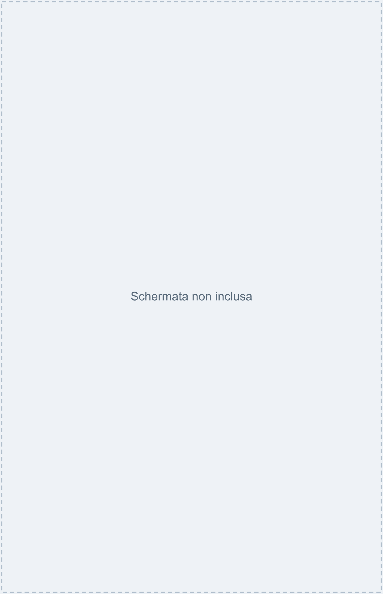
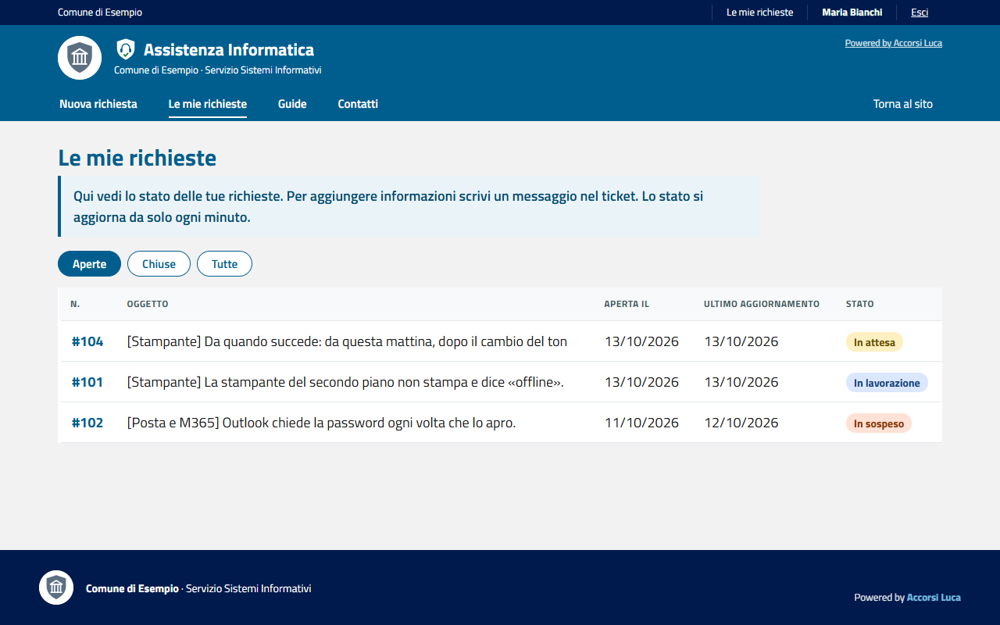
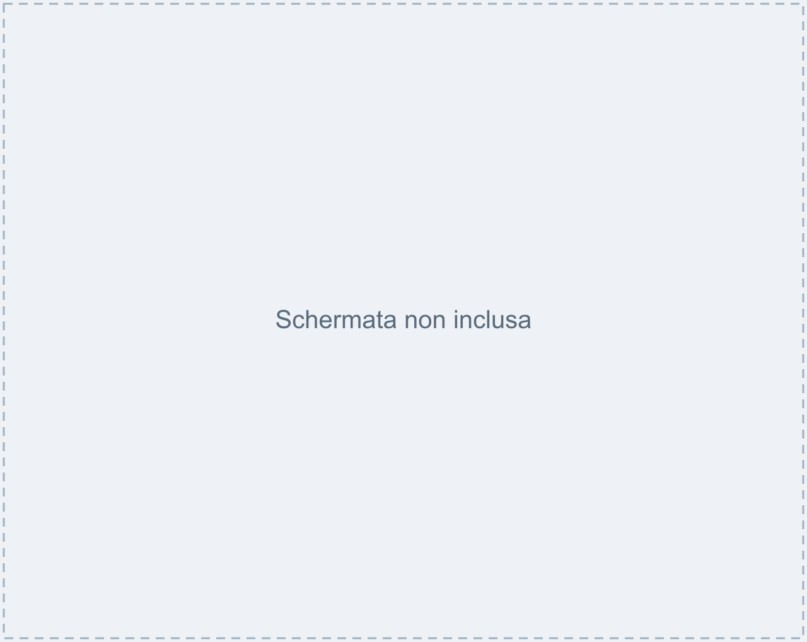
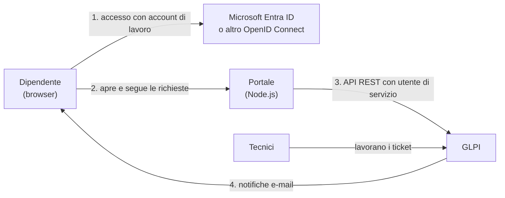

# Assistenza Portale

Un portale web semplice per far aprire ai dipendenti le **richieste di assistenza informatica** e seguirne lo stato, collegato a **GLPI**. Pensato per Comuni ed Enti pubblici, riusabile da chiunque.

[](LICENSE)



---

## Indice

1. [Cos'è](#cosè)
2. [Come funziona](#come-funziona)
3. [Cosa ti serve](#cosa-ti-serve)
4. [Provalo in 2 minuti (modalità demo)](#provalo-in-2-minuti-modalità-demo)
5. [Installazione passo passo](#installazione-passo-passo)
6. [Personalizzazione](#personalizzazione)
7. [Guide per utenti e tecnici](#guide-per-utenti-e-tecnici)
8. [Sicurezza](#sicurezza)
9. [Domande frequenti](#domande-frequenti)
10. [Come contribuire](#come-contribuire)
11. [Licenza e crediti](#licenza-e-crediti)

---

## Cos'è

Molti uffici chiedono assistenza al servizio informatico **per telefono o per mail**: le richieste si perdono e nessuno sa a che punto sono. Questo portale mette ordine:

- il dipendente entra con il suo **account di lavoro** (per esempio Microsoft 365), sceglie il tipo di problema con un clic, lo descrive e incolla uno screenshot con **Ctrl+V**;
- prima dell'invio il portale propone **consigli rapidi** («Prima di inviare, prova così») in base a quello che scrive;
- al ticket si aggiungono da soli **nome del PC** (se il portale è aperto dall'icona sul desktop), IP e browser;
- riceve subito il **numero della richiesta**;
- vede lo stato in **«Le mie richieste»** (In attesa, In lavorazione, In sospeso, Risolta, Chiusa) e può aggiungere messaggi;
- quando il ticket è risolto, dalla mail può rispondere **«Risolto, grazie»** o **«Non è risolto, riapri»**;
- i tecnici lavorano in **GLPI**, che resta il loro strumento: il dipendente non entra mai in GLPI.

È pensato per chi usa poco il computer: testi semplici, caselle grandi e colorate, niente gergo tecnico.

| Le mie richieste | Dettaglio di una richiesta |
|---|---|
|  |  |

Funziona anche su telefono: vedi [screenshots/](screenshots/).

## Come funziona



- Il portale è un'applicazione **separata** da GLPI: non modifica il codice di GLPI e parla con lui solo tramite le **API REST**, con un utente di servizio dai permessi minimi.
- Ogni richiesta diventa un **ticket GLPI** con richiedente, categoria, descrizione e allegati.
- Le e-mail ai dipendenti le invia **GLPI** con le sue notifiche (è fornito un modello di mail già pronto).

## Cosa ti serve

| Cosa | Note |
|---|---|
| Un server Linux | Debian 12 o 13 (provato su Debian 13). Può essere lo stesso server di GLPI. |
| GLPI 11 con MariaDB | Provato con GLPI 11.0.8 e MariaDB 11.8. GLPI 10 non è stato provato. |
| Apache | Come reverse proxy HTTPS (va bene anche lo stesso Apache di GLPI). |
| Node.js 20 o superiore | Su Debian 13 è nel pacchetto `nodejs`. |
| Account di lavoro con OpenID Connect | Microsoft 365 / Entra ID (esempio principale) o un altro provider OIDC. |
| Una casella e-mail per le notifiche | Invio diretto Microsoft 365 oppure un server SMTP. |
| Un nome DNS e un certificato HTTPS | Es. `portale.tuoente.it`. Microsoft Entra accetta solo indirizzi https. |

**Tempi indicativi**: prova in demo 2 minuti; installazione completa mezza giornata per chi conosce già GLPI e Linux (stima dell'autore, dipende molto dall'ambiente).

## Provalo in 2 minuti (modalità demo)

La modalità demo usa un **GLPI finto** e un **accesso simulato**: non servono GLPI né Microsoft. Serve solo [Node.js](https://nodejs.org/) 20 o superiore.

```bash
git clone https://github.com/realfulvio/assistenza-portale.git
cd assistenza-portale
npm install
npm run demo
```

Apri **http://127.0.0.1:3000/assistenza/** e premi «Entra nella demo». Trovi tre richieste di esempio e puoi aprirne di nuove. I dati spariscono quando chiudi il programma (Ctrl+C).

*Stato*: `npm install` e `npm run demo` sono testati su Windows 11 con Node 22. Il comando `git clone` diventerà utilizzabile quando il repository sarà pubblico.

> La demo non va mai usata in produzione: chiunque potrebbe entrare.

## Installazione passo passo

Qui trovi la sintesi. Ogni passo ha una guida dettagliata in [docs/](docs/). Le guide indicano per ogni comando se è stato testato.

1. **Preparare GLPI e le API** – abilita l'API REST e crea un client API con *app token*. → [docs/glpi.md](docs/glpi.md)
   *Cosa dovresti vedere*: in GLPI, *Configurazione > Generale > API*, l'API attiva e il client «Portale Assistenza». *Errore tipico*: `ERROR_WRONG_APP_TOKEN_PARAMETER` se il token è sbagliato o l'IP del client API non corrisponde.
2. **Utente di servizio e token** – crea l'utente (es. `portale-api`) con un profilo a privilegi minimi e genera il suo *token API*. → [docs/glpi.md](docs/glpi.md)
   *Errore tipico*: `ERROR_GLPI_LOGIN_USER_TOKEN` se il token non è valido.
3. **Registrare l'app in Microsoft Entra ID** (o nel tuo provider OIDC) con il redirect `https://<tuo-portale>/assistenza/auth/callback`. → [docs/accesso-microsoft-entra.md](docs/accesso-microsoft-entra.md)
4. **Scaricare il progetto** sul server (es. in `/opt/portale-assistenza`) ed eseguire `npm install --omit=dev`. → [docs/installazione.md](docs/installazione.md)
5. **Configurare** `.env` (copia di `.env.example`) e `config/ente.json` (copia di `config/ente.example.json`). → [docs/installazione.md](docs/installazione.md), [docs/personalizzazione.md](docs/personalizzazione.md)
6. **Avviare con systemd** usando `deploy/portale-assistenza.service`.
   *Cosa dovresti vedere*: `systemctl status portale-assistenza` → `active (running)`. *Errore tipico*: «Configurazione incompleta: …» nel log se manca una variabile.
7. **Apache e HTTPS** con `deploy/apache/assistenza.conf.example`. → [docs/apache-reverse-proxy.md](docs/apache-reverse-proxy.md), certificato con CA interna: [docs/certificati-ca-interna.md](docs/certificati-ca-interna.md)
8. *(Facoltativo)* **Login Microsoft anche in GLPI** e profilo «Tecnico Ticket». → [docs/sso-glpi.md](docs/sso-glpi.md)
9. **Notifiche e-mail** con il modello pronto. → [docs/notifiche-mail.md](docs/notifiche-mail.md)
10. *(Facoltativo)* **Icona sul desktop** con il nome del PC (GPO). → [docs/icona-desktop.md](docs/icona-desktop.md)
11. **Verifica**: accedi al portale, apri una richiesta di prova con uno screenshot e controlla in GLPI richiedente, categoria, gruppo e allegato. Poi elimina il ticket di prova.

## Personalizzazione

Tutto quello che riguarda il tuo ente sta in **un solo file**, `config/ente.json`:

- nome dell'ente, nome del servizio, sottotitolo, e-mail e telefono per le urgenze, link «Torna al sito»;
- logo/stemma (metti il file in `public/img/` e indica il nome);
- colori (predefiniti: blu `#005e8e`, barra `#001a4d`, sfondo `#f2f2f2`).

Le **categorie** dei problemi (nome, descrizione, icona, colore, categoria GLPI collegata) stanno in `config/categorie.json`; le **domande frequenti** in `content/faq.json`. → [docs/personalizzazione.md](docs/personalizzazione.md)

## Guide per utenti e tecnici

In [docs/guide-pdf/](docs/guide-pdf/) trovi due guide d'esempio in PDF, con dati inventati, da adattare al tuo ente:

- `guida-utenti.pdf` – come aprire e seguire una richiesta;
- `guida-tecnici.pdf` – come lavorare i ticket in GLPI.

## Sicurezza

- **Non pubblicare mai**: il file `.env`, `config/ente.json` se contiene dati interni, i certificati e le chiavi (`*.key`, `*.crt`), il file dei segreti di Apache, `glpicrypt.key` e `config_db.php` di GLPI, i dump del database. Il `.gitignore` li esclude già, ma controlla sempre prima di un `git push`.
- **Ruota i segreti**: il *client secret* di Entra ha una scadenza (massimo 24 mesi). Annotala e rinnovalo prima, vedi [docs/accesso-microsoft-entra.md](docs/accesso-microsoft-entra.md).
- **Aggiorna** periodicamente: `npm audit`, aggiornamenti di Debian, GLPI e Node.js. → [docs/aggiornamento-e-backup.md](docs/aggiornamento-e-backup.md)
- Protezioni già presenti: CSRF, cookie `HttpOnly`/`Secure`/`SameSite=Lax`, Content Security Policy, limiti e controllo del tipo reale degli allegati, limite di richieste per utente, controllo lato server che un utente veda solo le proprie richieste.
- Per segnalare una vulnerabilità vedi [SECURITY.md](SECURITY.md).

## Domande frequenti

**Devo usare per forza Microsoft 365?**
No. Il portale usa OpenID Connect standard: va bene qualsiasi provider OIDC (le istruzioni dettagliate però sono per Microsoft Entra ID).

**I dipendenti devono avere un account in GLPI?**
No. Il portale cerca l'utente in GLPI per e-mail e, se non c'è, lo crea con il profilo Self-Service senza password utilizzabile. Gli utenti esistenti (es. i tecnici) non vengono mai modificati.

**Posso cambiare categorie, testi e colori senza programmare?**
Sì: sono file JSON (vedi [docs/personalizzazione.md](docs/personalizzazione.md)).

**Il portale salva dati?**
No, tutto resta in GLPI. Gli allegati passano in memoria e vanno direttamente a GLPI.

**Funziona con GLPI 10?**
Non è stato provato. L'API REST usata (`/apirest.php`) esiste anche in GLPI 10, ma alcuni dettagli potrebbero cambiare.

## Come contribuire

Segnalazioni e proposte sono benvenute: leggi [CONTRIBUTING.md](CONTRIBUTING.md). Per i problemi usa le *Issues* del repository.

## Licenza e crediti

Distribuito con licenza **EUPL-1.2** (European Union Public Licence): vedi [LICENSE](LICENSE) e [NOTICE](NOTICE).

Sviluppato da **Luca Accorsi** — https://github.com/realfulvio

È un progetto personale dell'autore, non un prodotto ufficiale di alcun ente. Le pubbliche amministrazioni possono riusarlo e adattarlo anche nello spirito dell'**art. 69 del CAD** (Codice dell'Amministrazione Digitale) sul riuso del software. Il progetto non è (ancora) pubblicato nel catalogo di Developers Italia.

Nel portale il credito «Powered by Accorsi Luca» compare nel piè di pagina e in alto a destra: è un normale testo modificabile in `config/ente.json`, ma ti chiediamo di lasciarlo se possibile.
