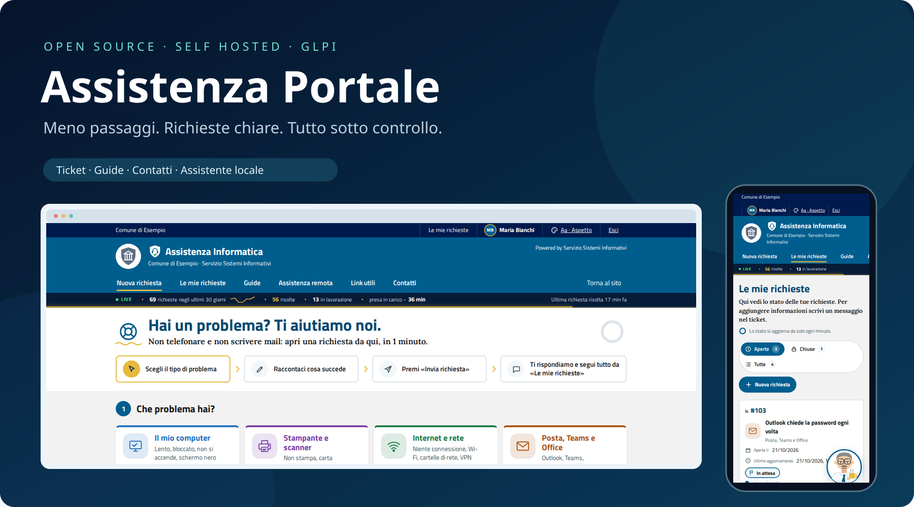
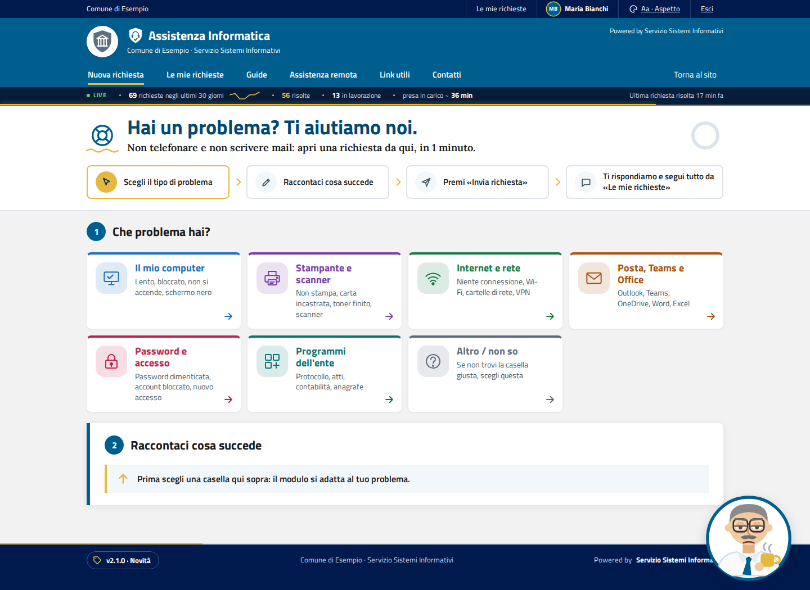
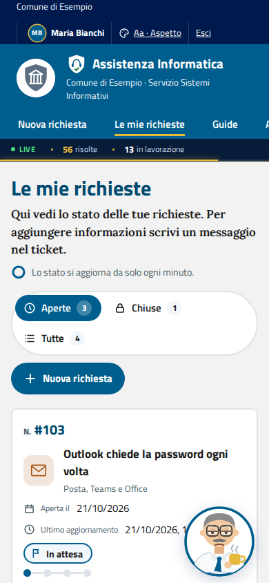
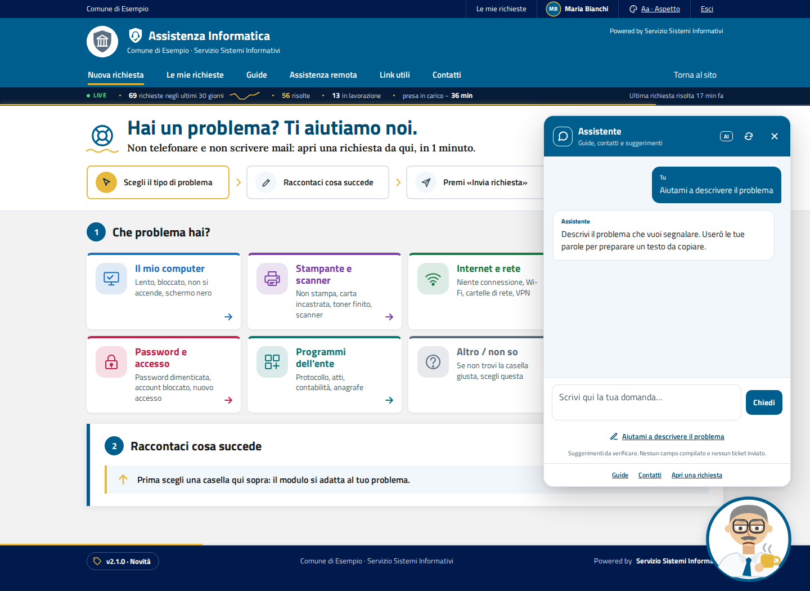
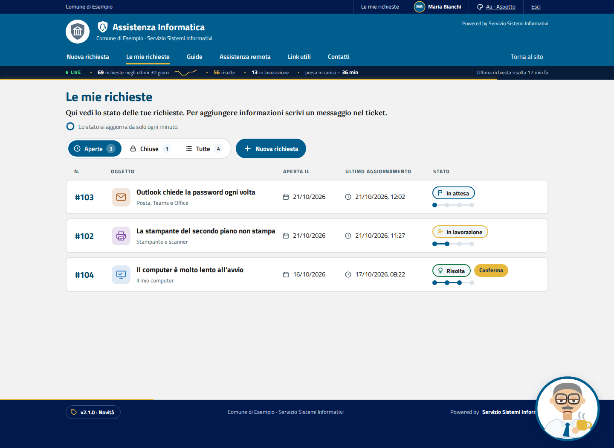
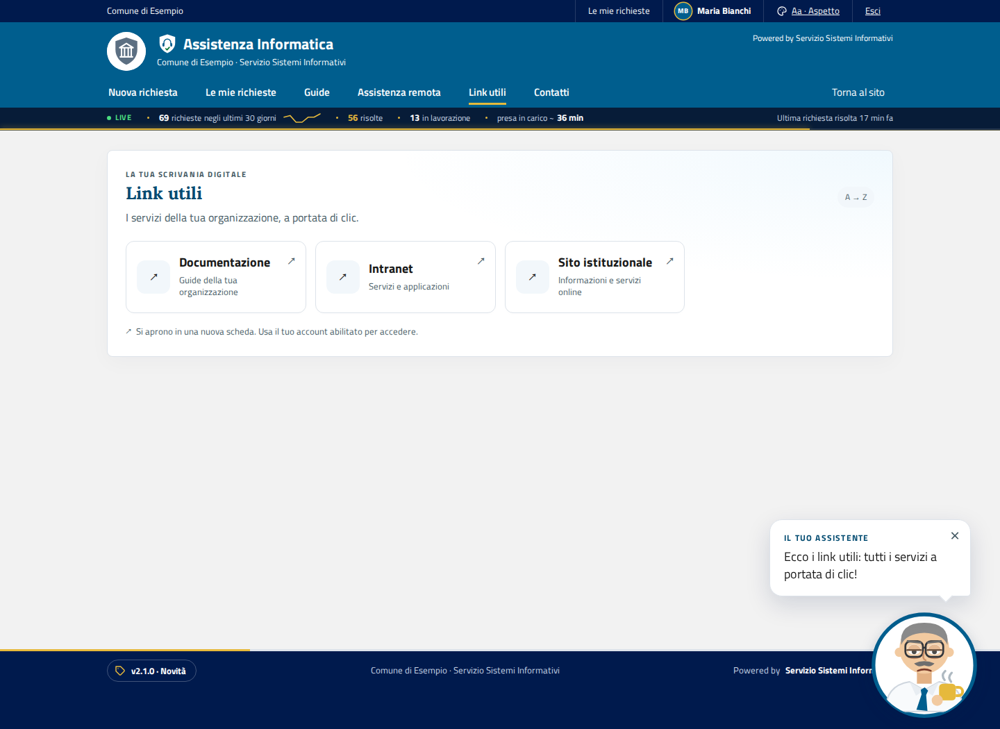
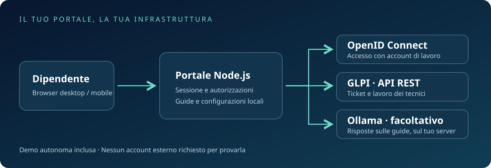

<div align="center">



# Assistenza Portale

**Un ingresso semplice per l’assistenza. GLPI al centro del lavoro dei tecnici.**

[](https://github.com/realfulvio/assistenza-portale/actions/workflows/ci.yml)
[](LICENSE)
[](https://nodejs.org/)
[](docs/glpi.md)

[Prova la demo](#provalo-in-due-minuti) · [Installazione](docs/installazione.md) · [Assistente locale](docs/assistente.md) · [Documentazione](docs/README.md)

</div>

Un portale per aprire e seguire richieste informatiche, consultare guide e trovare i contatti giusti. Chi chiede aiuto usa un’interfaccia guidata; i tecnici ricevono e gestiscono i ticket in **GLPI**, attraverso le sue API, senza modificarne il codice.

Pensato per organizzazioni ed enti pubblici. Nome, logo, categorie, contatti e collegamenti si adattano alla propria installazione.

## Il portale in azione

<table><tr><td width="66%"></td><td width="34%"></td></tr></table>

**Scegli → Descrivi → Invia → Segui.** Numero di richiesta, stato e conversazione rimangono nello stesso posto. Le immagini sono acquisite dalla demo: organizzazione, persone, numeri e ticket sono inventati.

| Funzione | Cosa trovi |
|---|---|
| Richieste guidate | Categorie, suggerimenti, allegati e screenshot incollati con Ctrl+V. |
| Conversazioni | Stato, risposte pubbliche, soluzione, conferma e riapertura. Le note private restano riservate in GLPI. |
| Assistente | Personaggio animato, ricerca nei contatti, lettura delle proprie richieste e preparazione del testo. Risposte sulle guide tramite Ollama facoltativo. |
| Guide e contatti | FAQ ricercabili e rubrica locale, con esempio sintetico incluso. |
| Link utili | Pagina di accesso ai servizi, configurabile in un JSON locale. |
| Assistenza remota | Istruzioni generiche per concordare un intervento con il tecnico. |
| Aspetto | Sette temi, dimensioni, spaziatura e movimento ridotto; preferenze legate all’account. |
| Profilo, PDF e statistiche | Foto personale, riepilogo stampabile e contatori aggregati. |
| Accesso | OpenID Connect, con guida per Microsoft Entra ID. |

## Un assistente dentro il portale



L’assistente consulta le guide e i contatti configurati, mostra le richieste del proprio utente e aiuta a descrivere un problema. La bozza resta nella chat: l’utente decide cosa copiare e inviare nel modulo. Il modello non invia, modifica o chiude ticket.

Contatti, richieste e preparazione del testo funzionano senza un modello. Per le risposte generative alle guide serve un’installazione **Ollama** separata; modelli e pesi non sono inclusi. [Configurazione e limiti](docs/assistente.md).

## Richieste e servizi, sempre a portata di mano

<table><tr><td width="50%"></td><td width="50%"></td></tr></table>

## Un’architettura semplice da ospitare



Il backend Node.js gestisce sessione e autorizzazioni. Le credenziali GLPI e OIDC restano sul server. In produzione usa HTTPS tramite reverse proxy e un utente API GLPI con privilegi minimi. [Architettura](docs/architettura.md) · [Sicurezza](SECURITY.md).

## Provalo in due minuti

Serve **Node.js 20.19 o superiore** e Git. Non servono GLPI, Microsoft 365 o Ollama per provare la demo.

```bash
git clone https://github.com/realfulvio/assistenza-portale.git
cd assistenza-portale
npm ci
npm run demo
```

Apri **http://127.0.0.1:3000/assistenza/** e scegli «Entra nella demo». I ticket sono simulati in memoria e si azzerano al riavvio. Preferenze e avatar possono restare in `data/`. Termina con Ctrl+C.

Puoi anche [scaricare lo ZIP dei sorgenti](https://github.com/realfulvio/assistenza-portale/archive/refs/heads/main.zip), estrarlo ed eseguire `npm ci` e `npm run demo` nella cartella estratta. Non serve una compilazione del frontend: HTML, CSS e JavaScript sono serviti direttamente da Node.js. `npm ci` installa anche i componenti nativi richiesti dalle dipendenze.

**La demo consente un accesso simulato: usala soltanto per prove locali.**

## Installa nella tua organizzazione

1. Prepara GLPI 11 e il suo utente API: [guida GLPI](docs/glpi.md).
2. Configura il provider di accesso: [Microsoft Entra / OIDC](docs/accesso-microsoft-entra.md).
3. Copia `.env.example` in `.env` e `config/ente.example.json` in `config/ente.json`; adatta categorie e contatti.
4. Installa le dipendenze con `npm ci --omit=dev`, configura il servizio e il reverse proxy HTTPS.
5. Verifica accesso, permessi e ciclo della richiesta nella tua installazione di test.

[Installazione completa](docs/installazione.md) · [Personalizzazione](docs/personalizzazione.md) · [Apache](docs/apache-reverse-proxy.md) · [Aggiornamento e backup](docs/aggiornamento-e-backup.md).

| Contenuto | File locale |
|---|---|
| Segreti, URL GLPI, OIDC e percorsi | `.env` |
| Nome, logo, colori e contatti del servizio | `config/ente.json` |
| Categorie e assegnazioni | `config/categorie.json` |
| Rubrica | `content/numeri-interni.json` |
| Collegamenti ai servizi | `config/link-utili.json` |

I file locali di questa tabella sono esclusi da Git. Le FAQ in `content/faq.json` sono invece versionate: prima di pubblicarle occorre sostituire qualsiasi contenuto interno. [Preparare una distribuzione pubblica](docs/pubblicazione-sicura.md).

### Link utili e footer

Copia `config/link-utili.example.json` in `config/link-utili.json` e configura i servizi della tua organizzazione, poi riavvia il portale. Le schede sono ordinate automaticamente per nome. Ogni voce può avere `nome`, `descrizione`, `url`, `icona` e un elenco `risorse` di collegamenti con `nome` e `url`. Senza URL principale, la scheda apre le risorse, ad esempio gli accessi alla postazione virtuale. Gli indirizzi accettano soltanto HTTP(S), senza credenziali incorporate.

Le icone SVG sono incluse nel codice: `applicazioni` (predefinita), `calendario`, `libro`, `mondo`, `posta`, `schermo`, `pagamenti` e `mappa`. Le risorse compaiono al passaggio del mouse e al focus; sui dispositivi touch restano visibili. Le animazioni rispettano la preferenza di movimento ridotto.

Il footer include Guide e FAQ, Contatti, una mappa espandibile, il progetto GitHub e la licenza. Crediti e versione mantengono le fonti configurate. Le informative o dichiarazioni specifiche di un'organizzazione vanno definite per la relativa installazione: gli esempi pubblici non includono testi o indirizzi dell'istanza operativa.

## Sviluppo e verifiche

```bash
npm ci
npx playwright install --with-deps chromium
npm run lint
npm test
npm run verifica:pubblico
```

Su Linux i test PDF richiedono anche `pdftotext` del pacchetto `poppler-utils`. La CI esegue i controlli su Node 20, 22 e 24. `npm run test:aspetto` verifica i temi nel browser. [Contribuire](CONTRIBUTING.md) · [Changelog](CHANGELOG.md).

## Licenza e crediti

**EUPL-1.2**, con i crediti e le licenze dei componenti in [LICENSE](LICENSE) e [NOTICE](NOTICE). Sviluppato dal **Servizio Sistemi Informativi**. Progetto personale dell’autore, non prodotto ufficiale di alcun ente. GLPI e gli altri prodotti citati appartengono ai rispettivi titolari.
