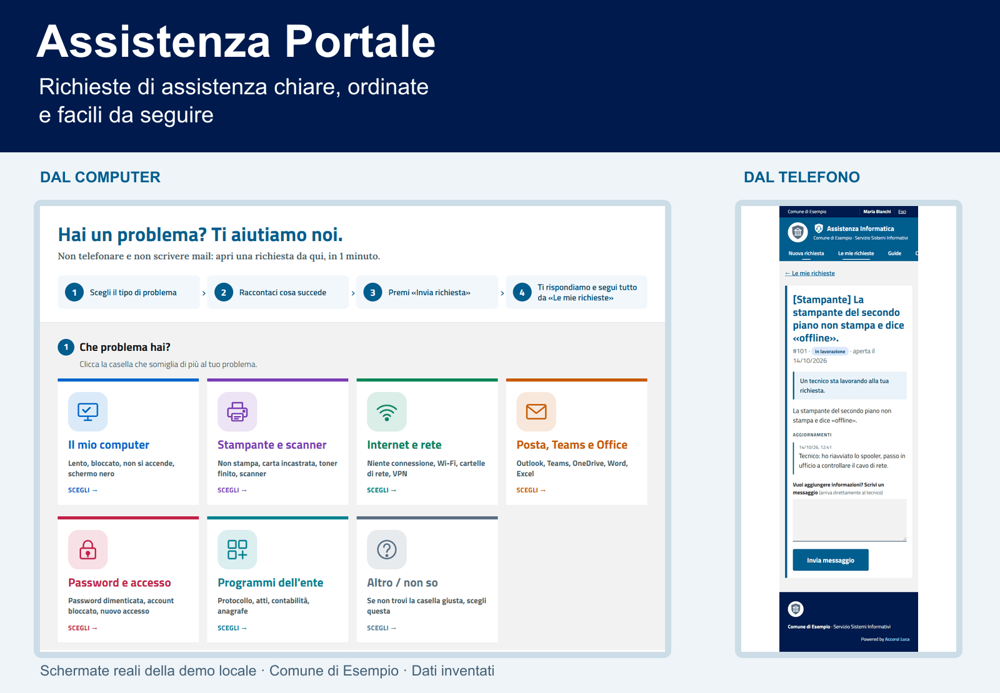
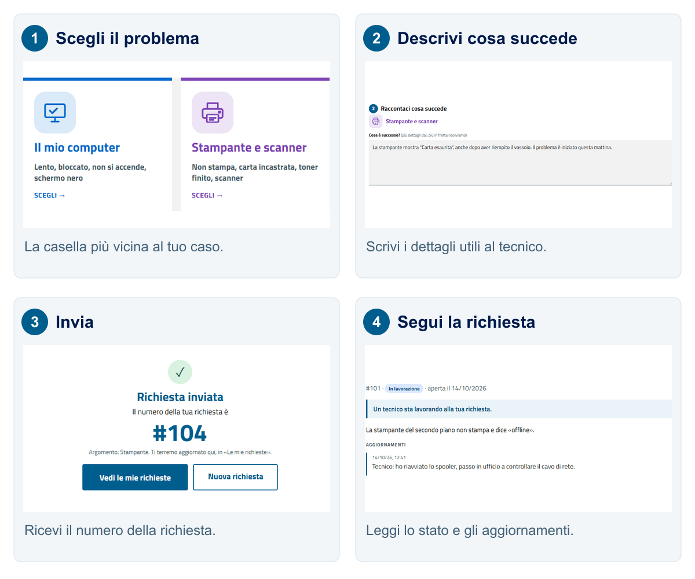
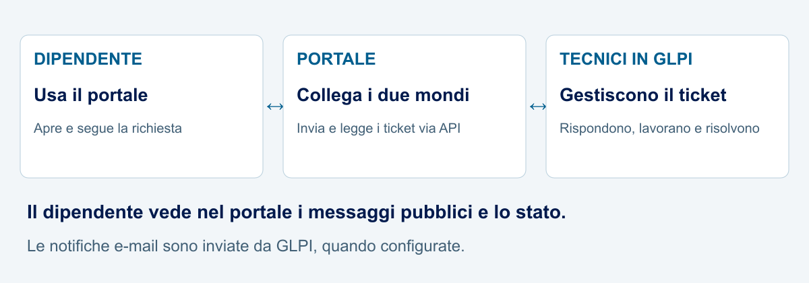
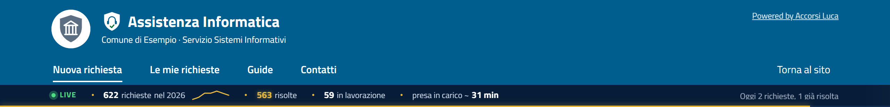
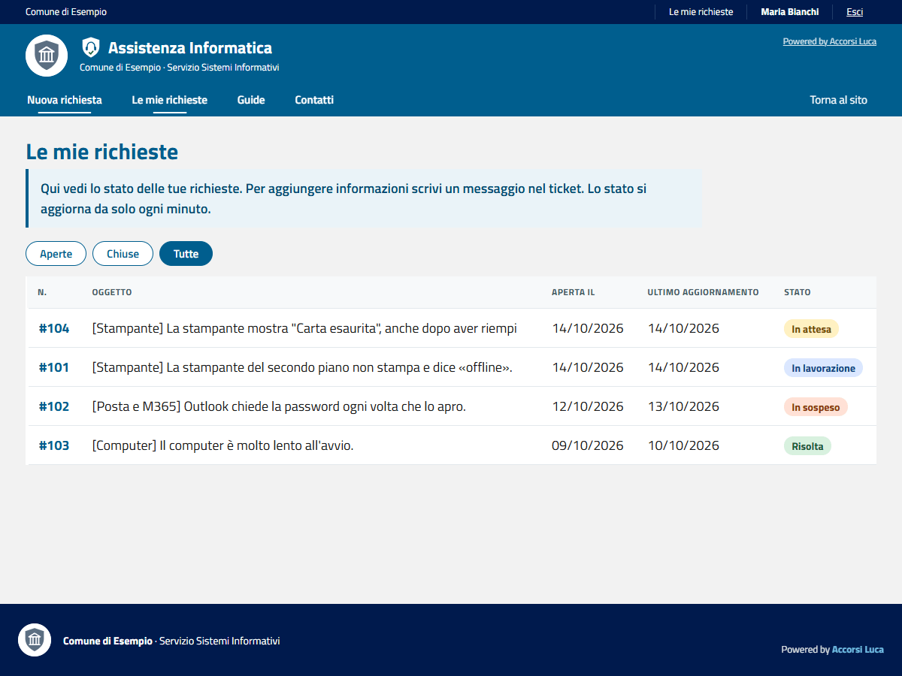
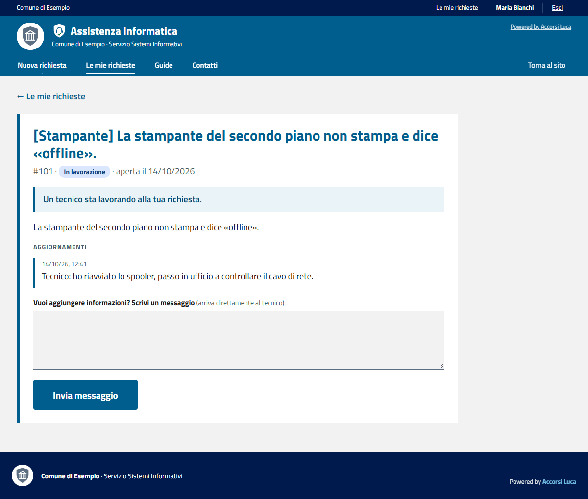

# Assistenza Portale

Un punto unico per **chiedere assistenza informatica e seguire la propria richiesta**, senza perdere messaggi tra telefonate e mail. Il dipendente usa un portale semplice; i tecnici continuano a lavorare in **GLPI**.

Pensato per Comuni ed Enti pubblici, riusabile da chiunque.

**[Prova la demo locale](#prova-la-demo-sul-tuo-computer)** · **[Installa il portale](#installazione-passo-passo)** · **[Consulta le guide](docs/README.md)**

## A cosa serve

Una stampante non funziona? Il computer si blocca? Il dipendente sceglie il problema, racconta cosa succede e riceve un numero di richiesta. Da **«Le mie richieste»** vede a che punto è il lavoro e legge le risposte del tecnico.

Ogni richiesta diventa un **ticket**, cioè una segnalazione numerata, in GLPI. Il dipendente non deve conoscere né usare GLPI.

## Come lo usa il dipendente

**Scegli il problema → Descrivi cosa succede → Invia → Segui la richiesta**

<picture>
  <source media="(max-width: 600px)" srcset="screenshots/presentation/percorso-mobile.png" />
  
</picture>

1. **Scegli il problema.** Computer, stampante, rete, posta, accesso o un altro argomento.
2. **Descrivi cosa succede.** Scrivi con parole tue; puoi allegare un file o incollare uno screenshot con **Ctrl+V**. Se disponibili, compaiono consigli rapidi prima dell'invio.
3. **Invia.** Ricevi il numero della richiesta, utile per ritrovarla.
4. **Segui la richiesta.** Controlla lo stato e gli aggiornamenti; aggiungi informazioni quando servono. Quando è risolta, puoi confermare la soluzione o chiedere di riaprirla.

- In **«Il mio profilo»** ognuno può mettere una foto personale oppure usare quella di Microsoft 365 (altrimenti si vedono le iniziali).
- Sotto il menu una sottile **barra «Live»** mostra il lavoro del servizio: richieste del periodo, risolte, in lavorazione, tempo medio di presa in carico (solo numeri aggregati).

Nell'installazione completa si entra con il proprio account di lavoro, per esempio Microsoft 365. La demo usa un accesso simulato.

## Come lavorano i tecnici

<picture>
  <source media="(max-width: 600px)" srcset="screenshots/presentation/ruolo-glpi-mobile.png" />
  
</picture>



Funziona anche su telefono: vedi [screenshots/](screenshots/).

I tecnici ricevono il ticket in **GLPI**: lo prendono in carico, registrano l'intervento, rispondono e descrivono la soluzione. Il dipendente vede nel portale **lo stato e i messaggi pubblici**; le note private restano riservate ai soggetti autorizzati in GLPI.

Le notifiche e-mail sono inviate da GLPI, quando configurate. Il portale è separato dal backend e comunica tramite API REST, con un utente di servizio dai permessi minimi: **non modifica il codice di GLPI**.

Il diagramma spiega il flusso: non è uno screenshot di GLPI. Per il dettaglio operativo vedi il [flusso dei ticket per i tecnici](docs/flusso-ticket-tecnici.md); per componenti, accesso e dati raccolti vedi la [guida tecnica](docs/architettura.md).

## Il portale in immagini

Schermate acquisite dalla **demo locale**, con «Comune di Esempio», persone e richieste inventate. Non sono ticket di produzione. Banner e percorso usano ritagli delle stesse schermate; gli esempi illustrano richieste sintetiche diverse.

### Le mie richieste



**Tutte le tue richieste in un elenco.** Il numero e lo stato aiutano a ritrovarle; i filtri distinguono aperte, chiuse e tutte.

### Dettaglio e aggiornamenti



**La conversazione resta insieme alla richiesta.** Leggi cosa sta facendo il tecnico e aggiungi le informazioni che mancano.

<details>
<summary><strong>Guarda la visualizzazione mobile e le altre schermate complete</strong></summary>

<p>Il dettaglio della richiesta a una larghezza di 390 px, acquisito nel browser della demo.</p>


- [Scelta del problema](screenshots/presentation/01-scelta.png)
- [Compilazione della richiesta](screenshots/presentation/02-descrizione.png)
- [Conferma dell'invio](screenshots/presentation/03-invio.png)
- [Tutte le immagini e la loro provenienza](screenshots/presentation/README.md)

</details>

## Vantaggi concreti

- **Un numero per ogni richiesta:** più facile ritrovarla e parlarne con l'assistenza.
- **Stato visibile:** il dipendente sa se è stata ricevuta, è in lavorazione, è in sospeso o è risolta.
- **Informazioni nello stesso posto:** descrizione, allegati e messaggi restano collegati al ticket.
- **Passaggi guidati:** categorie comprensibili, suggerimenti e campi con esempi.
- **GLPI resta lo strumento dei tecnici:** il portale semplifica l'accesso dei dipendenti.
- **Adattabile al proprio ente:** nomi, logo, colori, categorie e testi si configurano senza cambiare il codice.

## Prova la demo sul tuo computer

La demo si avvia **sul tuo computer**, con un accesso simulato e richieste inventate: non servono account Microsoft né un server GLPI. Non è un servizio pubblico online. Serve solo [Node.js](https://nodejs.org/) 20.19 o superiore.

```bash
git clone https://github.com/realfulvio/assistenza-portale.git
cd assistenza-portale
npm install
npm run demo
```

Apri **http://127.0.0.1:3000/assistenza/** e premi «Entra nella demo». Trovi tre richieste di esempio e puoi aprirne di nuove. I ticket simulati spariscono quando chiudi il programma (Ctrl+C). Preferenze e foto della demo restano invece nelle rispettive directory locali (`data/` o percorsi configurati).

*Verifica effettuata*: demo avviata su Windows 11 con Node 22; apertura, invio di una richiesta sintetica e consultazione delle richieste verificati nel browser. Le notifiche e-mail e un backend GLPI reale non sono inclusi nella demo.

> La demo non va mai usata in produzione: chiunque potrebbe entrare.

## Istruzioni e riferimenti

[Requisiti](#cosa-ti-serve) · [Installazione](#installazione-passo-passo) · [Personalizzazione](#personalizzazione) · [Guide](#guide-per-utenti-e-tecnici) · [Sicurezza](#sicurezza) · [Domande frequenti](#domande-frequenti) · [Contributi](#come-contribuire) · [Licenza e crediti](#licenza-e-crediti)

## Cosa ti serve

| Cosa | Note |
|---|---|
| Un server Linux | Debian 12 o 13 (provato su Debian 13). Può essere lo stesso server di GLPI. |
| GLPI 11 con MariaDB | Provato con GLPI 11.0.8 e MariaDB 11.8. GLPI 10 non è stato provato. |
| Apache | Come reverse proxy HTTPS (va bene anche lo stesso Apache di GLPI). |
| Node.js 20.19 o superiore | Su Debian 13 è nel pacchetto `nodejs`. |
| Account di lavoro con OpenID Connect | Microsoft 365 / Entra ID (esempio principale) o un altro provider OIDC. |
| Una casella e-mail per le notifiche | Invio diretto Microsoft 365 oppure un server SMTP. |
| Un nome DNS e un certificato HTTPS | Es. `portale.tuoente.it`. Microsoft Entra accetta solo indirizzi https. |

## Installazione passo passo

Qui trovi la sintesi. Ogni passo ha una guida dettagliata in [docs/](docs/). Le guide indicano per ogni comando se è stato testato.

1. **Preparare GLPI e le API** – abilita l'API REST e crea un client API con *app token*. → [docs/glpi.md](docs/glpi.md)
   *Cosa dovresti vedere*: in GLPI, *Configurazione > Generale > API*, l'API attiva e il client «Portale Assistenza». *Errore tipico*: `ERROR_WRONG_APP_TOKEN_PARAMETER` se il token è sbagliato o l'IP del client API non corrisponde.
2. **Utente di servizio e token** – crea l'utente (es. `portale-api`) con un profilo a privilegi minimi e genera il suo *token API*. → [docs/glpi.md](docs/glpi.md)
   *Errore tipico*: `ERROR_GLPI_LOGIN_USER_TOKEN` se il token non è valido.
3. **Registrare l'app in Microsoft Entra ID** (o nel tuo provider OIDC) con il redirect `https://<tuo-portale>/assistenza/auth/callback`. → [docs/accesso-microsoft-entra.md](docs/accesso-microsoft-entra.md)
4. **Scaricare il progetto** sul server (es. in `/opt/portale-assistenza`) ed eseguire `npm install --omit=dev`. → [docs/installazione.md](docs/installazione.md)
5. **Configurare** `.env` (copia di `.env.example`) e `config/ente.json` (copia di `config/ente.example.json`). → [docs/installazione.md](docs/installazione.md), [docs/personalizzazione.md](docs/personalizzazione.md)
6. **Avviare con systemd** usando `deploy/portale-assistenza.service`.
   *Cosa dovresti vedere*: `systemctl status portale-assistenza` → `active (running)`. *Errore tipico*: «Configurazione incompleta: …» nel log se manca una variabile.
7. **Apache e HTTPS** con `deploy/apache/assistenza.conf.example`. → [docs/apache-reverse-proxy.md](docs/apache-reverse-proxy.md), emissione con CA interna: [docs/certificati-ca-interna.md](docs/certificati-ca-interna.md), fiducia sui PC Windows in dominio: [docs/https-ca-dominio.md](docs/https-ca-dominio.md)
8. *(Facoltativo)* **Login Microsoft anche in GLPI** e profilo «Tecnico Ticket». → [docs/sso-glpi.md](docs/sso-glpi.md)
9. **Notifiche e-mail** con il modello pronto. → [docs/notifiche-mail.md](docs/notifiche-mail.md)
10. *(Facoltativo)* **Icona sul desktop** con il nome del PC (GPO). → [docs/icona-desktop.md](docs/icona-desktop.md)
11. **Verifica**: accedi al portale, apri una richiesta di prova con uno screenshot e controlla in GLPI richiedente, categoria, gruppo e allegato. Poi elimina il ticket di prova.

## Personalizzazione

Tutto quello che riguarda il tuo ente sta in **un solo file**, `config/ente.json`:

- nome dell'ente, nome del servizio, sottotitolo, e-mail e telefono per le urgenze, link «Torna al sito»;
- logo/stemma (metti il file in `public/img/` e indica il nome);
- colori (predefiniti: blu `#005e8e`, barra `#001a4d`, sfondo `#f2f2f2`);
- barra «Live» dei contatori (`barraLive`: attiva, periodo `giorni` (predefinito: ultimi 30) / `anno` / `mese` / `da_data`, durata della cache).

Le **categorie** dei problemi (nome, descrizione, icona, colore, categoria GLPI collegata) stanno in `config/categorie.json`; le **domande frequenti** in `content/faq.json`. → [docs/personalizzazione.md](docs/personalizzazione.md)

## Guide per utenti e tecnici

Per il backend GLPI sono disponibili il [flusso dei ticket per i tecnici](docs/flusso-ticket-tecnici.md) (Risposta, Attività, soluzione e ticket chiusi) e l'[esempio CSS opzionale per la nuova Risposta](docs/glpi-css-risposta.md), verificato su GLPI 11.0.8. Sono documentazione e personalizzazione opzionale di GLPI, senza modifiche al codice del portale. Tutte le guide sono nell'[indice della documentazione](docs/README.md).

In [docs/guide-pdf/](docs/guide-pdf/) trovi due guide d'esempio in PDF, con dati inventati, da adattare al tuo ente:

- `guida-utenti.pdf` – come aprire e seguire una richiesta;
- `guida-tecnici.pdf` – come lavorare i ticket in GLPI.

I PDF sono esempi da adattare; per i dettagli aggiornati sul ciclo di gestione e sulla chiusura fai riferimento alla guida del flusso in Markdown collegata sopra.

## Sicurezza

- **Non pubblicare mai**: il file `.env`, `config/ente.json` se contiene dati interni, i certificati e le chiavi (`*.key`, `*.crt`), il file dei segreti di Apache, `glpicrypt.key` e `config_db.php` di GLPI, i dump del database. Il `.gitignore` li esclude già, ma controlla sempre prima di un `git push`.
- **Ruota i segreti**: il *client secret* di Entra ha una scadenza (massimo 24 mesi). Annotala e rinnovalo prima, vedi [docs/accesso-microsoft-entra.md](docs/accesso-microsoft-entra.md).
- **Aggiorna** periodicamente: `npm audit`, aggiornamenti di Debian, GLPI e Node.js. → [docs/aggiornamento-e-backup.md](docs/aggiornamento-e-backup.md)
- Protezioni già presenti: CSRF, cookie `HttpOnly`/`Secure`/`SameSite=Lax`, Content Security Policy, limiti e controllo del tipo reale degli allegati, limite di richieste per utente, controllo lato server che un utente veda solo le proprie richieste.
- Per segnalare una vulnerabilità vedi [SECURITY.md](SECURITY.md).

## Domande frequenti

**Devo usare per forza Microsoft 365?**
No. Il portale usa OpenID Connect standard: va bene qualsiasi provider OIDC (le istruzioni dettagliate però sono per Microsoft Entra ID).

**I dipendenti devono avere un account in GLPI?**
No. Il portale cerca l'utente in GLPI per e-mail e, se non c'è, lo crea con il profilo Self-Service senza password utilizzabile. Gli utenti esistenti (es. i tecnici) non vengono mai modificati.

**Posso cambiare categorie, testi e colori senza programmare?**
Sì: sono file JSON (vedi [docs/personalizzazione.md](docs/personalizzazione.md)).

**Il portale salva dati?**
Richieste, utenti e allegati restano in GLPI; gli allegati passano soltanto in memoria. Dalla v2 il portale conserva anche le preferenze personali e le foto profilo in directory locali persistenti (`PREFERENCES_DIR` e `AVATAR_DIR`), da includere nei [backup](docs/aggiornamento-e-backup.md).

**Funziona con GLPI 10?**
Non è stato provato. L'API REST usata (`/apirest.php`) esiste anche in GLPI 10, ma alcuni dettagli potrebbero cambiare.

## Versioni

Il numero è nel file `VERSION` (unica fonte) e compare nel piè di pagina; le novità sono nel [CHANGELOG](CHANGELOG.md). Si usa il [versionamento semantico](https://semver.org/lang/it/):

- **MAJOR** cambia l'interfaccia o rompe la compatibilità;
- **MINOR** aggiunge funzioni;
- **PATCH** corregge errori.

### Novità della 2.0

- **Temi animati** (Classico, Hawaii, Spazio, Giardino, Retro, più quelli della 1.x) con pannello «Aspetto»: tema, dimensioni e spaziatura seguono l'account. Le palette sono in `scripts/genera-temi.js`, che controlla anche i contrasti (`node scripts/genera-temi.js`).
- **Nuova richiesta** con pulsanti rapidi per argomento (`rapidi` in `config/categorie.json`) e conferma animata.
- **Richieste a conversazione** con avanzamento, «Gestita da» e foto, solo con contenuti pubblici.
- **Riepilogo PDF** e stampa di ogni richiesta, generati dal portale.

## Come contribuire

Segnalazioni e proposte sono benvenute: leggi [CONTRIBUTING.md](CONTRIBUTING.md). Per i problemi usa le *Issues* del repository.

## Licenza e crediti

Distribuito con licenza **EUPL-1.2** (European Union Public Licence): vedi [LICENSE](LICENSE) e [NOTICE](NOTICE).

Sviluppato da **Luca Accorsi** — https://github.com/realfulvio

È un progetto personale dell'autore, non un prodotto ufficiale di alcun ente. Le pubbliche amministrazioni possono riusarlo e adattarlo anche nello spirito dell'**art. 69 del CAD** (Codice dell'Amministrazione Digitale) sul riuso del software. Il progetto non è (ancora) pubblicato nel catalogo di Developers Italia.

Nel portale il credito «Powered by Accorsi Luca» compare nel piè di pagina e in alto a destra: è un normale testo modificabile in `config/ente.json`, ma ti chiediamo di lasciarlo se possibile.
