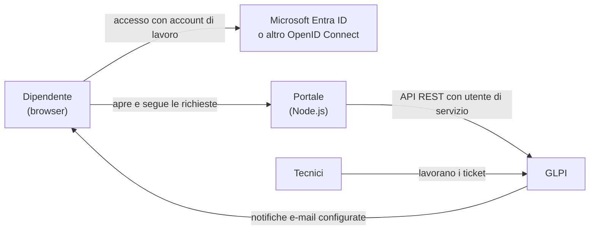

# Componenti e dati della richiesta

Il dipendente usa il portale; i tecnici lavorano nel backend GLPI. Il portale è un'applicazione separata e non modifica il codice di GLPI: comunica tramite API REST con un utente di servizio dai permessi minimi.

Ogni richiesta diventa un ticket con richiedente, categoria, descrizione e allegati. Il dipendente riceve un numero, vede lo stato e può aggiungere messaggi pubblici dal portale. Le note private e le attività dei tecnici non compaiono nella cronologia del dipendente.

Prima dell'invio, se il testo corrisponde ai suggerimenti configurati, il portale può mostrare consigli rapidi senza bloccare la richiesta. Gli allegati possono essere scelti, trascinati o incollati come screenshot con Ctrl+V, nel rispetto dei limiti configurati.

Al ticket vengono aggiunti anche IP e browser. Il nome del PC è disponibile quando il portale viene aperto dal collegamento desktop configurato con il relativo parametro: non viene rilevato automaticamente dal browser. Vedi [collegamento desktop e nome del PC](icona-desktop.md).

Le notifiche e-mail sono inviate da GLPI secondo la sua configurazione. Quando una richiesta è risolta, i pulsanti nella mail rimandano al portale per confermare «Risolto, grazie» oppure «Non è risolto, riapri». Vedi [notifiche](notifiche-mail.md) e [flusso dei ticket](flusso-ticket-tecnici.md).

La demo locale sostituisce GLPI e l'accesso con componenti simulati in memoria; non è una prova delle notifiche o di un'installazione GLPI reale. Per avviarla vedi il [README](../README.md#prova-la-demo-sul-tuo-computer).
